<table>
  <tr>
    <td valign="top"></td>
    <td valign="top"></td>
  </tr>
</table>

 

### Shipped

**[LegalPocketAI](https://apps.apple.com/app/id6758971238)**: legal-document AI for iPhone. It explains legal documents in plain language. Swift/SwiftUI app, Next.js + Supabase backend. Live on the App Store.

### Projects

| | |
|---|---|
| [**x64-arm64-aot**](https://github.com/RINNECODER/x64-arm64-aot) | Ahead-of-time recompiler: x86-64 PS5 executables to native ARM64 via LLVM IR (experimental) |
| [**AnyPS5**](https://github.com/RINNECODER/AnyPS5) | PS5 game runtime for macOS on Apple silicon: QEMU/TCG guest CPU, native HLE libraries, Metal GPU backend (fork of boykopovar/AnyPS5) |
| [**jev-behavior-study**](https://github.com/RINNECODER/jev-behavior-study) | Independent behavior study of TypeSafe Jev 1.13: controlled prompt experiments, raw results, offline verification |
| [**timestral-research**](https://github.com/RINNECODER/timestral-research) | Fine-tuning setup and findings for Mistral's Timestral time-series models, benchmarked on Kalshi BTC 15-min markets |
| [**jev-box-study**](https://github.com/RINNECODER/jev-box-study) | What worked and what didn't building an AI-image hallucination detector on Jev Box |
| [**agent-keychain**](https://github.com/RINNECODER/agent-keychain) | Let AI agents use API keys without ever seeing them: macOS Keychain MCP server (early alpha) |
